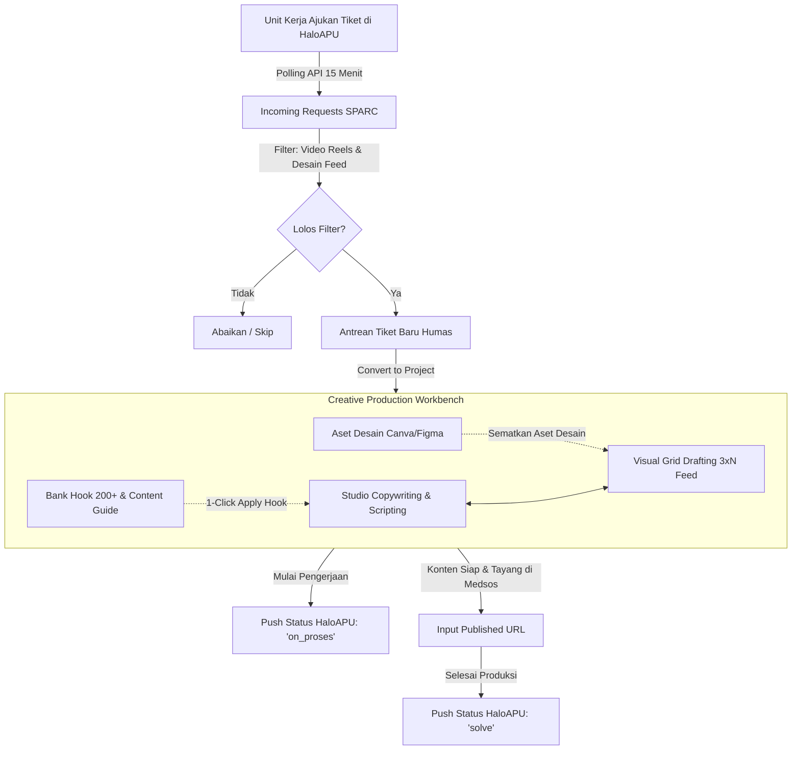

# PRODUCT REQUIREMENTS DOCUMENT (PRD)
## SPARC — Social Media Production, Asset & Resource Center (Humas)

| Atribut Dokumen | Detail Spesifikasi |
| :--- | :--- |
| **Nama Produk** | SPARC (Social Media Production, Asset & Resource Center) |
| **Versi & Tanggal** | Versi 2.0 — 27 Oktober 2026 |
| **Status Dokumen** | Final — Decision-Complete |
| **Akses Pengguna** | *Flat Collaborative Workspace* (Invite-Only, akses setara tanpa sekat birokrasi role) |
| **Integrasi Utama** | REST API HaloAPU (Unit Humas: Video Reels & Desain Feed Instagram/Meme) |
| **Referensi Kerja** | Rapiin App Expert 2024 (Copywriting, Visual Grid Drafting, Hook & Design Resource Library) |
| **Scope Fungsional** | Incoming HaloAPU, Copywriting & Script Studio, Visual Grid Drafting, Creative Resource Library |
| **Scope Dikecualikan** | Dashboard, Content Planner (Tabel/Kanban sheet), Calendar, Report (dihapus sesuai arahan) |
| **Target Stack** | Laravel 13, Inertia.js v3, React 19, TypeScript, Tailwind CSS v4, shadcn/ui, MySQL 8 |
| **Target Lingkungan** | cPanel Shared Hosting (PHP 8.3, Cron Scheduler, Queue Database, Polling 30 Detik) |

---

## 1. Ringkasan Eksekutif & Latar Belakang Produk

Tim Hubungan Masyarakat (Humas) menghadapi tantangan dalam mengeksekusi permintaan publikasi konten media sosial yang masuk dari aplikasi *ticketing* internal (**HaloAPU**). Pengajuan naskah, referensi visual, dan materi desain yang dikirimkan unit pemohon sering kali harus diolah secara manual ke dalam format skrip video atau rancangan *feed* Instagram yang estetik dan konsisten.

**SPARC** hadir sebagai *creative production workbench* terpadu yang menjembatani tiket pengajuan dari HaloAPU langsung ke meja kerja tim kreatif (penulis naskah dan desainer grafis). Berdasarkan evaluasi alur kerja dan eliminasi modul yang tidak dibutuhkan (Dashboard analitik, kalender penjadwalan, tabel planner umum, dan pelaporan performa dieksklusi), SPARC memfokuskan seluruh kapabilitasnya pada 4 pilar operasional kreatif:
1. **Penerimaan & Sinkronisasi Tiket Otomatis (Incoming HaloAPU):** Menarik pengajuan konten dari HaloAPU secara terjadwal (polling 15 menit), menyaring khusus tiket Reels dan Feed Instagram/Meme, serta mengirimkan pembaruan status pengerjaan secara dua arah.
2. **Studio Copywriting & Naskah (Scripting Studio):** Ruang penyusunan naskah terstruktur per format—pemecahan *slide-by-slide* untuk Instagram Carousel dan *frame-by-frame / Hook-Body-CTA* untuk naskah video Reels/Shorts.
3. **Visual Grid Drafting:** Kanvas visual interaktif berupa *grid* 3 kolom (simulasi estetika *feed* Instagram 3xN) dan kanvas *mockup* thumbnail YouTube/Reels untuk menata tata letak visual sebelum materi tayang.
4. **Creative Resource Library (Bank Referensi & Aset):** Pusat amunisi kreatif yang terintegrasi langsung ke editor, mencakup Bank 200+ Template Hook Konten, Panduan Pilar & Moodboard Humas, serta Direktori Template Desain Canva/Figma siap pakai.

---

## 2. Alur Kerja End-to-End (End-to-End Workflow)



| Tahap | Entitas / Modul | Mekanisme & Aksi Sistem |
| :--- | :--- | :--- |
| **1. Intake Tiket** | HaloAPU API Sync | SPARC mengecek tiket HaloAPU tiap 15 menit. Tiket yang sesuai kriteria Humas dimasukkan ke tabel antrean `incoming_tickets`. Jika brief tiket di HaloAPU diubah oleh pemohon, SPARC merekam *diff* perubahannya. |
| **2. Inisiasi Proyek** | Modul Incoming | Anggota tim Humas meninjau *brief*, lampiran foto/dokumen, dan target tanggal. Klik tombol **"Convert to Project"** untuk membuat entitas proyek konten (`creative_projects`). |
| **3. Produksi Naskah** | Copywriting Studio | Penulis menyusun skrip. Untuk video Reels: membagi naskah menjadi *Hook*, *Body*, dan *CTA* dengan bantuan *Hook Bank*. Untuk feed: membagi naskah per *slide carousel*. Status otomatis berubah ke *In Progress*, memicu callback HaloAPU menjadi `on_proses`. |
| **4. Penyusunan Visual** | Grid Drafting | Desainer menempatkan gambar/desain pada kanvas *Grid 3 Kolom* Instagram Feed untuk melihat harmoni warna dan susunan *feed*. Desainer juga menyematkan tautan template Canva/Figma dari *Design Directory*. |
| **5. Finalisasi & Publikasi**| Final Review & Callback | Setelah materi disetujui dan ditayangkan di media sosial, staf memasukkan tautan tayang (`published_url`). SPARC otomatis mengirim status `solve` beserta tautan tayang ke HaloAPU sebagai bukti penyelesaian tiket. |

---

## 3. Arsitektur Teknis & Batasan Lingkungan cPanel

Aplikasi dibangun dengan stack modern yang ringan dan kompatibel dengan lingkungan *shared hosting* cPanel:
* **Backend:** Laravel 13 (PHP 8.3).
* **Frontend:** Inertia.js v3 + React 19 + TypeScript.
* **Styling & Komponen:** Tailwind CSS v4 + shadcn/ui + Lucide React.
* **Database:** MySQL 8.0 / MariaDB 10.6+.

### 3.1 Penyesuaian Khusus cPanel Shared Hosting
1. **Antrean Pekerjaan (Queue Driver):** Menggunakan driver `database` (tabel `jobs`). cPanel Cron Job dijalankan tiap menit untuk memproses antrean:
   ```cron
   * * * * * cd /home/<user>/sparc && php artisan schedule:run >> /dev/null 2>&1
   ```
   Scheduler Laravel akan mengeksekusi `queue:work --stop-when-empty` setiap menit dan `haloapu:sync` setiap 15 menit.
2. **Tanpa WebSocket / Node Server Persistent:** Pembaruan antarmuka *real-time* menggunakan mekanisme *short-polling* ringan setiap 30 detik melalui endpoint `GET /poll/updates?since=<timestamp>`.
3. **Session & Cache Driver:** Menggunakan driver `file` lokal (`storage/framework/sessions` dan `storage/framework/cache`) untuk menghindari ketergantungan Redis atau memcached.
4. **Penyimpanan Berkas (File Storage):** Menggunakan disk `public` lokal (`storage/app/public` yang di-*symlink* ke `public/storage`) hanya untuk avatar pengguna dan berkas draft sementara. Lampiran tiket HaloAPU diakses langsung melalui URL publik HaloAPU tanpa diunduh ulang (menghemat kapasitas hosting).

---

## 4. Integrasi REST API HaloAPU (Spesifikasi Lengkap)

Integrasi SPARC dengan HaloAPU bersifat *non-intrusive* (sama sekali tidak mengubah kode sumber aplikasi HaloAPU).

### 4.1 Kredensial & Autentikasi Integrasi
* Akun khusus dibuat pada panel HaloAPU: `sparc-bot@internal.local` dengan role **Koordinator** pada unit kerja **Humas**. Role ini memiliki wewenang `scopeAccessibleBy` dan `isAccessibleBy` atas seluruh tiket unit Humas.
* Token API didapatkan melalui endpoint `POST /api/login` HaloAPU dengan payload `{email, password, is_admin: true}` tanpa menyertakan `device_id` (agar tidak memicu *device lock*).
* Karena HaloAPU menggunakan konfigurasi Sanctum `'expiration' => null`, token bersifat permanen dan disimpan di file `.env` SPARC:
  ```env
  HALOAPU_API_URL=https://haloapu.domain.id/api
  HALOAPU_WEB_URL=https://haloapu.domain.id
  HALOAPU_API_TOKEN=1|AbCdEfGhIjKlMnOpQrStUvWxYz...
  ```

### 4.2 Aturan Penyaringan Tiket (Strict Ingestion Filter)
SPARC hanya memproses dan menyimpan tiket yang memenuhi salah satu dari dua kondisi presisi berikut:
1. **Sub-unit Video:** Kolom `category` bernilai `"Editing & Produksi Video"` DAN field form JSON `description` memuat label `"Jenis Video"` dengan nilai `"Reels"`.
2. **Sub-unit Desain:** Kolom `category` bernilai `"Pengajuan Desain Grafis"` DAN field form JSON `description` memuat label `"Jenis Produksi Desain"` dengan nilai `"Feed Instagram / Meme"`.

Tiket HaloAPU di luar ketentuan tersebut (misalnya Motion Graphic, Video Dokumentasi, Banner Cetak, Spanduk) dilewati tanpa disimpan ke database.

### 4.3 Pemetaan Kolom Data Tiket
Saat tiket lolos penyaringan, data dipetakan ke tabel `incoming_tickets`:

| Atribut SPARC | Sumber Tiket Video Reels | Sumber Tiket Desain Feed |
| :--- | :--- | :--- |
| `haloapu_ticket_id` | ID numerik HaloAPU (tanpa tanda strip `-`) | Sama |
| `source_type` | `video_reels` | `desain_feed` |
| `title` | Nilai label form `"Judul/Tema Video"` | `"Feed IG — " + Ringkasan "Brief Materi" (maks 80 char)` |
| `brief` | Nilai label form `"Brief Video"` | Nilai `"Brief Materi"` + `\n\nTujuan: ` + `"Tujuan Penggunaan"` |
| `target_date` | Nilai label `"Deadline Tayang"` (YYYY-MM-DD) | Nilai label `"Deadline"` (YYYY-MM-DD) |
| `requester_name` | Kolom `requesterName` response API | Sama |
| `form_snapshot` | Seluruh pasangan label-nilai form (`description`) | Sama |
| `attachments_json`| Array objek lampiran `[{fileName, url}]` | Sama |
| `content_hash` | Hash SHA-256 dari `description + status` | Sama |

### 4.4 Sinkronisasi Dua Arah & Callback Status
Callback status dikirim melalui HTTP POST ke `{HALOAPU_API_URL}/tickets/{id}/status` dengan header `Authorization: Bearer {HALOAPU_API_TOKEN}`:
* **Perubahan ke `on_proses`:** Dipicu ketika proyek kreatif yang terhubung dengan tiket mulai dikerjakan (memasuki status `in_scripting` atau `in_design`), dan status tiket di HaloAPU masih `open` atau `pending`.
  * Catatan yang dikirim: *"Sedang diproduksi tim Humas (SPARC)."*
* **Perubahan ke `solve`:** Dipicu ketika proyek diselesaikan dan telah memiliki tautan tayang publikasi (`published_url`).
  * Catatan yang dikirim: *"Konten telah dipublikasikan:\n- URL: {published_url}\nCatatan: {upload_notes}"* (dipotong maks 1000 karakter).
* **Penanganan Error:**
  * Kode status HTTP 422 dengan pesan *"Status sudah..."* dianggap sukses (idempoten).
  * Kegagalan jaringan atau 5xx dicoba ulang otomatis sebanyak 3 kali (backoff: 1 menit, 5 menit, 15 menit). Jika tetap gagal, sistem menandai flag `haloapu_push_failed = true` dan memunculkan tombol *Retry* manual di antarmuka.

---

## 5. Spesifikasi Modul Fungsional

### 5.1 Modul 1: Incoming HaloAPU (Daftar Pengajuan Masuk)
Antarmuka sentral untuk memantau pengajuan materi dari unit kerja:
* **Tabel Antrean:**
  * Menampilkan Nomor Tiket HaloAPU (`XXX-XXX-XXX`), Badge Jenis (`Video Reels` / `Desain Feed`), Judul, Nama Pemohon, Target Tanggal, Status HaloAPU, dan Status SPARC (`pending`, `converted`, `ignored`).
  * Filter tab cepat: *Semua*, *Reels*, *Feed Instagram*.
  * Filter status: *Menunggu Tindakan*, *Sudah Dikonversi*, *Diabaikan*.
* **Slide-over Rincian Tiket (Detail Drawer):**
  * Membuka panel samping kanan saat baris tiket diklik.
  * Menampilkan seluruh data formulir asli pengajuan (`form_snapshot`).
  * Daftar tautan lampiran berkas yang langsung mengarah ke storage publik HaloAPU (`target="_blank"`).
  * Tombol **"Buka di HaloAPU"** yang membuka halaman tiket admin HaloAPU di tab baru.
  * Indikator peringatan jika pemohon memperbarui *brief* di HaloAPU setelah tiket masuk (menampilkan *diff* nilai lama vs nilai baru).
  * Indikator peringatan jika pemohon mengajukan revisi (`need_revision`) atau membatalkan tiket.
* **Tindakan Konversi (Convert to Project):**
  * Mengonversi tiket menjadi 1 atau beberapa proyek konten kreatif (`creative_projects`).
  * Form modal: Judul Proyek, Format (`Reels/Shorts`, `Carousel Feed`, `Single Image Feed`), Penanggung Jawab (PIC), Target Selesai.
  * Tiket yang telah dikonversi ditandai status `converted`.
* **Tindakan Ignore & Undo:**
  * Memungkinkan staf mengabaikan tiket yang tidak relevan tanpa menghapusnya, serta membatalkan status abaikan (*undo*).

### 5.2 Modul 2: Studio Copywriting & Naskah (Scripting Studio)
Ruang kerja digital untuk menyusun naskah dan *copywriting* sebelum masuk ke tahap desain:
* **Struktur Naskah Berbasis Format:**
  * **Format Carousel Feed (Multi-Slide):** Editor *slide-by-slide* (Slide 1: Cover/Hook, Slide 2–N: Daging Konten/Value, Slide Akhir: Call to Action). Penulis dapat menambah, mengurutkan ulang (*drag-and-drop*), atau menghapus slide.
  * **Format Video Reels (Multi-Frame):** Editor naskah berbasis segmen waktu/frame dengan 3 blok wajib:
    1. *The Hook (Detik 0–3):* Kalimat pembuka visual & audio untuk menghentikan *scrolling*.
    2. *The Core Value (Detik 4–45):* Penjelasan poin inti, edukasi, atau narasi.
    3. *The Call to Action (Detik Akhir):* Ajakan simpan, bagikan, komentar, atau kunjungi tautan.
* **Integrasi Langsung dengan Bank Hook:**
  * Tombol modal **"Pilih dari Hook Bank"** langsung di dalam editor naskah. Penulis dapat mencari hook berdasarkan kategori dan mengklik **"Gunakan Hook Ini"** untuk langsung menempelkan teks ke dalam kolom Hook.
* **Atribut Copywriting Lengkap:**
  * Teks *Caption* Instagram & pemilihan *Hashtag*.
  * Kolom catatan sutradara / instruksi visual untuk desainer (contoh: *"tampilkan footage kegiatan di menit 00:15"*).
  * Tautan referensi konten (*moodboard / benchmark*).
  * Tombol 1-klik: **"Salin Seluruh Naskah"** dan **"Salin Caption Saja"** ke *clipboard*.

### 5.3 Modul 3: Visual Grid Drafting (Kanvas Visual Feed & Thumbnail)
Modul untuk menyusun tata letak visual konten media sosial secara realistis sebelum materi dipublikasikan:
* **Kanvas Instagram Feed (Grid 3 Kolom):**
  * Menampilkan representasi visual profil Instagram dalam format matriks 3 kolom x N baris.
  * Setiap slot kartu menampilkan gambar *preview* desain, judul konten, status produksi, dan nomor urut slot.
  * Kemampuan *drag-and-drop* antar-slot untuk menata pola visual feed (misalnya pola catur, baris tematik, atau estetika palet warna).
  * Slot kosong (*Placeholder Slot*) dapat ditambahkan untuk merencanakan konsep postingan masa depan.
* **Kanvas Thumbnail YouTube / Reels Cover:**
  * Tampilan *mockup* rasio 16:9 (YouTube) dan 9:16 (Reels/TikTok).
  * Pengunggahan berkas gambar rancangan *cover/thumbnail* untuk menguji keterbacaan teks judul pada layar perangkat seluler (*mobile preview*).
* **Detail Panel per Slot:**
  * Menampilkan tautan proyek copywriting terkait.
  * Tombol sematkan tautan template Canva atau berkas kerja Figma.
  * Catatan revisi desain (*designer notes*).
  * Kolom pengisian **Published URL** saat konten telah tayang di media sosial resmi.

### 5.4 Modul 4: Creative Resource Library (Pusat Amunisi Konten)
Direktori aset referensi terpusat yang diadaptasi dari template spreadsheet referensi:
* **4.1 Bank Template Hook (List Hook):**
  * Koleksi 200+ formula *hook* konten teruji.
  * Kategori: *Pertanyaan Ajakan*, *Personalisasi*, *Edukasi & Rahasia*, *Masalah & Solusi (Pain-Gain)*, *Kontroversial Ringan*, *Storytelling Opening*.
  * Fitur pencarian kata kunci dan filter per kategori.
  * Aksi cepat: tombol salin ke *clipboard* dan tombol terapkan ke naskah aktif.
* **4.2 Panduan Pilar & Moodboard Humas (Content Guide):**
  * Katalog pilar konten resmi Humas:
    * *Pilar 1: Edukasi Publik* (Panduan layanan, tips, regulasi).
    * *Pilar 2: Publikasi Kegiatan & Event* (Liputan seremonial, seminar, kunjungan).
    * *Pilar 3: Sosialisasi Program & Prestasi* (Pencapaian lembaga, penghargaan).
    * *Pilar 4: Pengumuman Resmi* (Hari libur, siaran pers, informasi darurat).
    * *Pilar 5: Human Touch & Behind the Scenes* (Aktivitas pegawai, budaya kerja).
  * Penjelasan objektif, target audiens, dan contoh *visual moodboard* (referensi desain acuan) pada setiap pilar.
* **4.3 Direktori Template Desain (List Design):**
  * Katalog tautan ke *bundle* template Canva, Figma, dan Google Drive tim Humas.
  * Pengelompokan: *Template Feed Tunggal*, *Template Carousel 5-10 Slide*, *Template Story / Cover Reels*, *Template Infografis*.
  * Setiap item memiliki pratinjau gambar, deskripsi format ukuran (1080x1080, 1080x1350, 1080x1920), dan tombol tautan langsung **"Buka Template di Canva/Figma"**.

### 5.5 Modul 5: Pengguna & Sistem Undangan (Invite-Only)
* Sistem akses tertutup khusus internal tim Humas.
* Form registrasi publik dinonaktifkan (`/register` mengembalikan 404).
* Pengguna yang sudah aktif dapat mengundang rekan kerja melalui menu **Undang Anggota** (`/invite`):
  * Memasukkan alamat email rekan tim.
  * Sistem menghasilkan token acak 64 karakter dengan masa berlaku 7 hari dan mengirimkan tautan undangan unik: `{APP_URL}/register/{token}`.
  * Penerima membuka tautan, melengkapi nama dan kata sandi, lalu langsung masuk ke ruang kerja.
* Semua pengguna memiliki hak akses penuh (*flat collaborative workspace*) untuk mengedit naskah, menyusun grid, dan memperbarui status tiket.

### 5.6 Modul 6: Notifikasi In-App
* Ikon lonceng pada bilah navigasi dengan penanda badge jumlah notifikasi belum dibaca (*unread count*).
* Polling otomatis setiap 30 detik.
* Pemicu notifikasi sistem:
  1. Tiket baru masuk dari HaloAPU yang lolos filter.
  2. Pemohon mengubah *brief* pada tiket yang sedang diproses (*brief updated diff*).
  3. Pemohon mengajukan revisi pada tiket (`need_revision`).
  4. Pemohon membatalkan tiket di HaloAPU.
  5. Callback pengiriman status ke HaloAPU gagal setelah 3 kali percobaan.
  6. Token autentikasi HaloAPU tidak valid (401 Unauthorized).
* Laci samping (drawer) notifikasi memuat riwayat 50 notifikasi terbaru dengan tombol *Tandai Telah Dibaca* dan navigasi langsung ke tiket/proyek terkait.

### 5.7 Modul 7: Keranjang Sampah (Trash & Recovery)
* Seluruh entitas penting (`incoming_tickets`, `creative_projects`, `grid_slots`) menerapkan *Soft Delete*.
* Halaman `/trash` menampilkan item yang dihapus beserta waktu penghapusan dan nama penghapus.
* Opsi: **Pulihkan (Restore)** untuk mengembalikan data ke posisi semula, atau **Hapus Permanen (Purge)** dengan dialog konfirmasi keamanan.
* Pembersihan otomatis (*auto-purge*) berkas dan data di keranjang sampah yang telah berusia lebih dari 30 hari via Laravel Scheduler harian.

---

## 6. Skema Database Relasional (MySQL 8 DDL)

Semua tabel menggunakan `id BIGINT UNSIGNED AUTO_INCREMENT PRIMARY KEY` dan kolom penanda waktu standar `created_at` serta `updated_at`.

```sql
-- 1. TABEL PENGGUNA
CREATE TABLE users (
    id BIGINT UNSIGNED AUTO_INCREMENT PRIMARY KEY,
    name VARCHAR(255) NOT NULL,
    email VARCHAR(255) NOT NULL UNIQUE,
    password VARCHAR(255) NOT NULL,
    avatar_path VARCHAR(500) NULL,
    timezone VARCHAR(50) DEFAULT 'Asia/Jakarta',
    remember_token VARCHAR(100) NULL,
    created_at TIMESTAMP NULL,
    updated_at TIMESTAMP NULL,
    deleted_at TIMESTAMP NULL
) ENGINE=InnoDB DEFAULT CHARSET=utf8mb4 COLLATE=utf8mb4_unicode_ci;

-- 2. TABEL UNDANGAN (INVITATIONS)
CREATE TABLE invitations (
    id BIGINT UNSIGNED AUTO_INCREMENT PRIMARY KEY,
    email VARCHAR(255) NOT NULL,
    token CHAR(64) NOT NULL UNIQUE,
    invited_by BIGINT UNSIGNED NOT NULL,
    expires_at TIMESTAMP NOT NULL,
    accepted_at TIMESTAMP NULL,
    created_at TIMESTAMP NULL,
    updated_at TIMESTAMP NULL,
    FOREIGN KEY (invited_by) REFERENCES users(id) ON DELETE CASCADE
) ENGINE=InnoDB DEFAULT CHARSET=utf8mb4 COLLATE=utf8mb4_unicode_ci;

-- 3. TABEL TIKET MASUK HALOAPU
CREATE TABLE incoming_tickets (
    id BIGINT UNSIGNED AUTO_INCREMENT PRIMARY KEY,
    haloapu_ticket_id BIGINT UNSIGNED NOT NULL UNIQUE,
    source_type ENUM('video_reels', 'desain_feed') NOT NULL,
    title VARCHAR(500) NOT NULL,
    brief TEXT NULL,
    requester_name VARCHAR(255) NOT NULL,
    target_date DATE NULL,
    haloapu_status VARCHAR(30) NOT NULL,
    form_snapshot JSON NOT NULL,
    attachments_json JSON NULL,
    content_hash CHAR(64) NOT NULL,
    sync_status ENUM('pending', 'converted', 'ignored') DEFAULT 'pending',
    last_synced_at TIMESTAMP NULL,
    created_at TIMESTAMP NULL,
    updated_at TIMESTAMP NULL,
    deleted_at TIMESTAMP NULL,
    INDEX idx_sync_status (sync_status),
    INDEX idx_source_type (source_type)
) ENGINE=InnoDB DEFAULT CHARSET=utf8mb4 COLLATE=utf8mb4_unicode_ci;

-- 4. TABEL LOG PERUBAHAN BRIEF TIKET
CREATE TABLE ticket_update_logs (
    id BIGINT UNSIGNED AUTO_INCREMENT PRIMARY KEY,
    incoming_ticket_id BIGINT UNSIGNED NOT NULL,
    changed_fields JSON NOT NULL,
    seen_at TIMESTAMP NULL,
    created_at TIMESTAMP NULL,
    updated_at TIMESTAMP NULL,
    FOREIGN KEY (incoming_ticket_id) REFERENCES incoming_tickets(id) ON DELETE CASCADE
) ENGINE=InnoDB DEFAULT CHARSET=utf8mb4 COLLATE=utf8mb4_unicode_ci;

-- 5. TABEL PROYEK KREATIF (CREATIVE PROJECTS)
CREATE TABLE creative_projects (
    id BIGINT UNSIGNED AUTO_INCREMENT PRIMARY KEY,
    incoming_ticket_id BIGINT UNSIGNED NULL,
    title VARCHAR(255) NOT NULL,
    format ENUM('reels_shorts', 'carousel_feed', 'single_feed') NOT NULL,
    pillar ENUM('edukasi', 'event_liputan', 'sosialisasi_prestasi', 'pengumuman', 'human_touch') NOT NULL,
    status ENUM('drafting', 'in_scripting', 'in_design', 'ready_to_publish', 'published') DEFAULT 'drafting',
    pic_user_id BIGINT UNSIGNED NULL,
    target_date DATE NULL,
    published_url VARCHAR(500) NULL,
    upload_notes TEXT NULL,
    caption TEXT NULL,
    hashtags TEXT NULL,
    haloapu_push_failed BOOLEAN DEFAULT FALSE,
    created_at TIMESTAMP NULL,
    updated_at TIMESTAMP NULL,
    deleted_at TIMESTAMP NULL,
    FOREIGN KEY (incoming_ticket_id) REFERENCES incoming_tickets(id) ON DELETE SET NULL,
    FOREIGN KEY (pic_user_id) REFERENCES users(id) ON DELETE SET NULL,
    INDEX idx_status (status),
    INDEX idx_format (format)
) ENGINE=InnoDB DEFAULT CHARSET=utf8mb4 COLLATE=utf8mb4_unicode_ci;

-- 6. TABEL BUTIR NASKAH (SCRIPT ITEMS: SLIDE / FRAME)
CREATE TABLE script_items (
    id BIGINT UNSIGNED AUTO_INCREMENT PRIMARY KEY,
    creative_project_id BIGINT UNSIGNED NOT NULL,
    item_type ENUM('slide', 'video_frame') NOT NULL,
    order_index INT UNSIGNED NOT NULL DEFAULT 1,
    title VARCHAR(255) NULL,
    hook_text TEXT NULL,
    body_text TEXT NULL,
    cta_text TEXT NULL,
    visual_notes TEXT NULL,
    created_at TIMESTAMP NULL,
    updated_at TIMESTAMP NULL,
    FOREIGN KEY (creative_project_id) REFERENCES creative_projects(id) ON DELETE CASCADE,
    INDEX idx_project_order (creative_project_id, order_index)
) ENGINE=InnoDB DEFAULT CHARSET=utf8mb4 COLLATE=utf8mb4_unicode_ci;

-- 7. TABEL SLOT GRID DRAFTING VISUAL
CREATE TABLE grid_slots (
    id BIGINT UNSIGNED AUTO_INCREMENT PRIMARY KEY,
    grid_type ENUM('instagram_feed_3x', 'youtube_thumbnail', 'reels_cover') NOT NULL,
    slot_position INT UNSIGNED NOT NULL,
    creative_project_id BIGINT UNSIGNED NULL,
    custom_title VARCHAR(255) NULL,
    preview_image_path VARCHAR(500) NULL,
    canva_link VARCHAR(500) NULL,
    figma_link VARCHAR(500) NULL,
    notes TEXT NULL,
    created_at TIMESTAMP NULL,
    updated_at TIMESTAMP NULL,
    deleted_at TIMESTAMP NULL,
    FOREIGN KEY (creative_project_id) REFERENCES creative_projects(id) ON DELETE SET NULL,
    INDEX idx_grid_pos (grid_type, slot_position)
) ENGINE=InnoDB DEFAULT CHARSET=utf8mb4 COLLATE=utf8mb4_unicode_ci;

-- 8. TABEL BANK HOOK (HOOK TEMPLATES)
CREATE TABLE hook_templates (
    id BIGINT UNSIGNED AUTO_INCREMENT PRIMARY KEY,
    category ENUM('pertanyaan', 'personalisasi', 'edukasi_rahasia', 'pain_gain', 'kontroversial', 'storytelling') NOT NULL,
    hook_text TEXT NOT NULL,
    context_example TEXT NULL,
    created_at TIMESTAMP NULL,
    updated_at TIMESTAMP NULL,
    INDEX idx_category (category)
) ENGINE=InnoDB DEFAULT CHARSET=utf8mb4 COLLATE=utf8mb4_unicode_ci;

-- 9. TABEL PANDUAN PILAR HUMAS (CONTENT GUIDES)
CREATE TABLE content_guides (
    id BIGINT UNSIGNED AUTO_INCREMENT PRIMARY KEY,
    pillar_key ENUM('edukasi', 'event_liputan', 'sosialisasi_prestasi', 'pengumuman', 'human_touch') NOT NULL,
    title VARCHAR(255) NOT NULL,
    objective TEXT NOT NULL,
    audience_target VARCHAR(255) NOT NULL,
    visual_moodboard_url VARCHAR(500) NULL,
    rules_and_dos_donts JSON NULL,
    created_at TIMESTAMP NULL,
    updated_at TIMESTAMP NULL
) ENGINE=InnoDB DEFAULT CHARSET=utf8mb4 COLLATE=utf8mb4_unicode_ci;

-- 10. TABEL TEMPLATE DESAIN (DESIGN TEMPLATES)
CREATE TABLE design_templates (
    id BIGINT UNSIGNED AUTO_INCREMENT PRIMARY KEY,
    title VARCHAR(255) NOT NULL,
    category ENUM('canva_feed', 'canva_carousel', 'canva_story', 'figma_component', 'drive_assets') NOT NULL,
    dimension VARCHAR(50) NOT NULL DEFAULT '1080x1080',
    thumbnail_url VARCHAR(500) NULL,
    external_url VARCHAR(500) NOT NULL,
    description TEXT NULL,
    created_at TIMESTAMP NULL,
    updated_at TIMESTAMP NULL,
    INDEX idx_category (category)
) ENGINE=InnoDB DEFAULT CHARSET=utf8mb4 COLLATE=utf8mb4_unicode_ci;

-- 11. TABEL LOG SINKRONISASI HALOAPU
CREATE TABLE haloapu_sync_logs (
    id BIGINT UNSIGNED AUTO_INCREMENT PRIMARY KEY,
    direction ENUM('pull', 'push') NOT NULL,
    incoming_ticket_id BIGINT UNSIGNED NULL,
    endpoint VARCHAR(255) NOT NULL,
    request_body JSON NULL,
    response_status SMALLINT NULL,
    response_body TEXT NULL,
    status ENUM('success', 'failed') NOT NULL,
    attempt TINYINT DEFAULT 1,
    created_at TIMESTAMP NULL,
    updated_at TIMESTAMP NULL,
    FOREIGN KEY (incoming_ticket_id) REFERENCES incoming_tickets(id) ON DELETE SET NULL,
    INDEX idx_sync_metrics (direction, status, created_at)
) ENGINE=InnoDB DEFAULT CHARSET=utf8mb4 COLLATE=utf8mb4_unicode_ci;
```

---

## 7. Desain Antarmuka & Tata Letak Ruang Kerja

### 7.1 Skema Warna & Identitas Brand SPARC
Antarmuka mengusung konsep *clean light workspace* dengan aksen semantik yang tegas:

| Token Warna Brand | Nilai Hex | Penggunaan Antarmuka |
| :--- | :--- | :--- |
| **SPARC Royal Blue** | `#1546D8` | Warna aksen navigasi aktif, tombol aksi primer (*Convert*, *Simpan Naskah*), badge tiket Reels. |
| **SPARC Emerald Green**| `#00A870` | Penanda status *Published*, indikator sinkronisasi HaloAPU sukses, badge tiket Feed Desain. |
| **SPARC Crimson Red** | `#D61F45` | Peringatan tiket dibatalkan, peringatan push callback gagal, tombol hapus / purge. |
| **SPARC Golden Spark**| `#F59E0B` | Status *In Scripting / In Design*, badge permintaan revisi dari HaloAPU, sorotan draft aktif. |

### 7.2 Struktur Navigasi Bilah Samping (Sidebar)
Bilah navigasi kiri mencakup 5 menu utama yang dirancang ringkas:
1. **Incoming HaloAPU (`/incoming`):** Daftar tiket antrean pengajuan konten dari unit kerja.
2. **Script Studio (`/studio`):** Ruang penyusunan naskah Carousel & video Reels.
3. **Grid Drafting (`/grid`):** Pratinjau visual susunan *feed* Instagram 3 kolom & cover thumbnail.
4. **Resource Library (`/resources`):** Tab terpadu untuk Hook Bank, Panduan Pilar, dan Template Desain.
5. **Trash (`/trash`):** Pemulihan data yang dihapus.

Bagian bawah sidebar memuat:
* Widget ringkas status koneksi HaloAPU (titik hijau berkedip saat sync aktif, waktu penarikan terakhir, jumlah tiket pending).
* Profil pengguna aktif & tombol logout.

---

## 8. Endpoint & Arsitektur Routing

### 8.1 Halaman Inertia (Web Routes)
Semua route dilindungi middleware `auth` kecuali alur login dan registrasi undangan:
* `GET  /login` → Halaman masuk.
* `GET  /register/{token}` → Form pendaftaran akun baru via undangan.
* `POST /register/{token}` → Simpan pengguna baru dan login otomatis.
* `GET  /invite` → Modal / form undang rekan tim Humas.
* `POST /invite` → Kirim tautan undangan ke email rekan kerja.
* `GET  /incoming` → Halaman antrean tiket HaloAPU.
* `POST /incoming/{id}/convert` → Konversi tiket ke proyek naskah/grid.
* `POST /incoming/{id}/ignore` → Abaikan tiket.
* `POST /incoming/{id}/unignore` → Batalkan abaikan tiket.
* `GET  /studio` → Daftar proyek naskah & studio penulisan.
* `GET  /studio/{id}` → Editor naskah slide / frame terperinci.
* `PATCH /studio/{id}` → Perbarui konten naskah, caption, dan status.
* `GET  /grid` → Kanvas pratinjau Grid Feed 3 Kolom & Thumbnail.
* `PATCH /grid/slots/reorder` → Perbarui urutan slot grid (*drag-and-drop*).
* `POST /grid/slots/{id}/upload-preview` → Unggah gambar mockup feed slot.
* `GET  /resources` → Bank Hook, Panduan Pilar, dan Template Desain.
* `GET  /trash` → Daftar data terhapus.
* `POST /trash/{type}/{id}/restore` → Pulihkan data.
* `DELETE /trash/{type}/{id}/purge` → Hapus permanen data.

### 8.2 Endpoint Polling & JSON Internal
* `GET  /poll/updates?since={timestamp}` → Memeriksa pembaruan tiket baru, badge notifikasi, dan status sync.
* `GET  /notifications` → Mengambil daftar notifikasi in-app.
* `POST /notifications/{id}/read` → Menandai notifikasi telah dibaca.
* `POST /notifications/read-all` → Menandai seluruh notifikasi telah dibaca.
* `POST /haloapu/sync-now` → Memicu penarikan manual tiket HaloAPU (dibatasi 1x per menit per user).
* `POST /projects/{id}/haloapu-retry` → Mencoba ulang push callback status HaloAPU yang gagal.

---

## 9. Kebutuhan Non-Fungsional (Non-Functional Requirements)

1. **Integritas & Idempotensi Data:** Penarikan tiket menggunakan identitas unik `haloapu_ticket_id`. Tiket yang ditarik berulang kali tidak akan menghasilkan data duplikat.
2. **Resiliensi Jaringan:** Kegagalan koneksi ke API HaloAPU saat proses penarikan (*pull*) maupun pengiriman callback (*push*) dicatat detail pada tabel `haloapu_sync_logs` tanpa menghentikan operasional aplikasi.
3. **Keamanan Kredensial:** Token HaloAPU dan kredensial database hanya tersimpan di berkas `.env` server dan tidak pernah diekspos ke respon JSON frontend.
4. **Optimasi Kinerja Antarmuka:** Pemuatan kanvas *Grid 3 Kolom* menggunakan optimasi gambar *lazy-loading* dan kompresi pratinjau agar tetap mulus saat memuat puluhan slot postingan.

---

## 10. Peta Jalan Pengembangan (Development Roadmap)

### Fase 1: Fondasi & Integrasi Inti (MVP)
* Setup scaffolding Laravel 13, Inertia React, Tailwind v4, dan komponen shadcn.
* Konfigurasi autentikasi invite-only (`/invite` dan `/register/{token}`).
* Migrasi skema database utama.
* Pembuatan Artisan Command `haloapu:sync` dan penjadwalan cPanel Cron.
* Antarmuka **Incoming HaloAPU** (tabel, slide-over detail, konversi proyek, ignore/unignore).
* Antarmuka **Script Studio** untuk penulisan naskah Carousel & Reels.
* Callback status dua arah ke HaloAPU (`on_proses` dan `solve`).
* Keranjang sampah (Trash & Soft Delete).

### Fase 2: Visual Grid Drafting & Resource Bank
* Kanvas interaktif **Grid Feed 3 Kolom Instagram** dengan drag-and-drop antar-slot.
* Mockup kanvas YouTube & Reels Thumbnail.
* Seeder & antarmuka **Bank Hook 200+ Template** dengan integrasi 1-klik ke Script Studio.
* Halaman **Panduan Pilar & Moodboard Humas** serta **Direktori Template Desain**.
* Polling otomatis 30 detik untuk notifikasi dan pembaruan tiket masuk.

### Fase 3: Peningkatan & Kolaborasi Lanjutan
* Fitur *live preview export* (mengunduh susunan grid feed sebagai satu bundel gambar utuh).
* Pengingat tenggat waktu otomatis bagi naskah yang belum diselesaikan mendekati tanggal tayang.
* Integrasi opsional publikasi langsung via API Meta/Instagram Graph API (jika izin API tersedia di masa mendatang).
