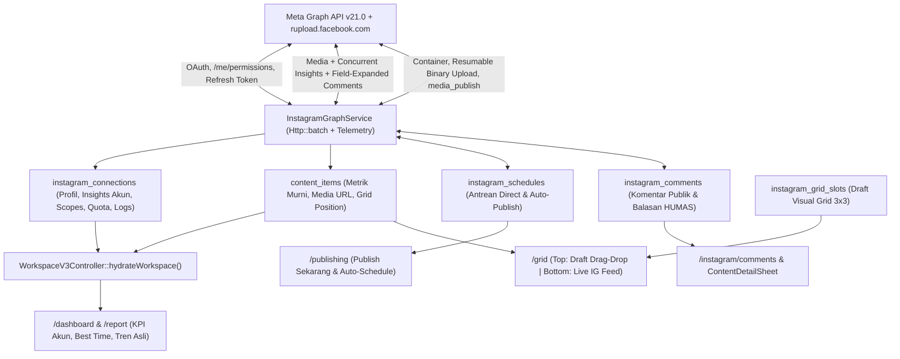

# Maksimalisasi Integrasi Instagram Graph API di SPARC v3

## Latar Belakang & Tujuan

Saat ini integrasi Meta / Instagram Graph API di [`InstagramGraphService.php`](file:///mnt/c/Users/IT%20Dev/Documents/SPARC/app/Services/InstagramGraphService.php) baru dimanfaatkan secara terbatas (sinkronisasi sekuensial ke tabel `content_items` dengan scope dasar) dan mengalami keterputusan aliran data ke modul-modul utama SPARC yang masih membaca state session statis.

Rencana ini memaksimalkan penggunaan API key & token Meta/Instagram secara menyeluruh pada **4 pilar terintegrasi**:
1. **Analitik Lengkap, Profil Akun & Penyatuan Data Lintas Modul** — menyatukan data `ContentItem` Eloquent ke Dashboard, Performance Report, Publishing, dan Visual Grid 3x3 asli (tersimpan di DB), menarik profil lengkap (`followers_count`, bio, avatar), Account Insights 28 hari, jam aktif audiens (`online_followers`), serta memisahkan metrik murni (`reach`, `views`, `likes`, `comments`, `shares`, `saves`) tanpa angka estimasi palsu.
2. **Direct Publishing & Penjadwalan Otomatis (Hybrid Media)** — mempublikasikan **Feed Single**, **Carousel**, dan **Reels** langsung dari `/publishing` (mode *Publish Sekarang* maupun *Auto-Publish Terjadwal* setelah lolos Checklist Pra-Publikasi), mendukung upload file lokal (Reels via *Resumable Binary Upload* `rupload.facebook.com`, Foto via URL storage publik/S3) maupun input URL HTTPS publik, dengan tetap mempertahankan opsi input URL manual.
3. **Inbox & Moderasi Komentar Publik HUMAS** — menarik komentar & balasan netizen secara efisien menggunakan *Graph Field Expansion*, menyediakan halaman **Inbox Komentar IG** terpusat (di grup *Distribution & Insights*) dan tab **Komentar IG** di [`ContentDetailSheet.tsx`](file:///mnt/c/Users/IT%20Dev/Documents/SPARC/resources/js/Components/ContentDetailSheet.tsx) untuk **Balas**, **Hide/Unhide**, **Hapus**, serta **Jadikan Ide Konten**.
4. **Smart OAuth Scopes, Efisiensi Kuota (`Http::batch`), Auto-Refresh Token & Hybrid Scheduler** — inspeksi izin aktif (`/me/permissions`), pencatatan kuota header `X-App-Usage` & log sinkronisasi di Settings, perpanjangan token otomatis sebelum 60 hari, serta eksekusi terjadwal via Laravel Scheduler + fallback non-blocking pada `/poll/updates`.

---

## User Review Required

> [!IMPORTANT]
> **Konfigurasi Izin (Permissions) di Meta Developer Console**
> Agar fitur *Direct Publishing* dan *Moderasi Komentar* aktif penuh saat otorisasi Facebook Login, pastikan pada aplikasi Meta Anda (di *Facebook Login for Business / Use Cases*) telah mengaktifkan scope: `instagram_basic`, `pages_show_list`, `pages_read_engagement`, `instagram_manage_insights`, `instagram_content_publish`, dan `instagram_manage_comments`. Di mode *Development*, seluruh admin/tester yang terdaftar di *App Roles* dapat langsung memakai izin ini tanpa menunggu *App Review*. Sistem SPARC juga akan dilengkapi *Smart Scope Toggle* di `/settings` agar login tidak pernah gagal (`Invalid Scopes`) bila salah satu izin belum diaktifkan di konsol Meta.

### Persyaratan URL Gambar Publik pada `localhost`

Untuk unggahan **Reels/Video lokal**, SPARC menggunakan endpoint *Resumable Binary Upload* (`rupload.facebook.com`) sehingga file video lokal dari komputer/server `localhost` langsung terkirim ke Meta. Untuk **Foto (Feed/Carousel)** dari file lokal, server Meta mewajibkan pengunduhan dari URL HTTPS publik; jika `APP_URL` masih berupa `localhost` tanpa disk publik/S3/tunnel, UI Publishing akan memberi peringatan pra-kirim dan mengarahkan penggunaan input URL HTTPS publik.

---

## Arsitektur Alur Data & Integrasi



---

## Proposed Changes

### 1. Database Migrations, Models & Factories

Menambahkan kolom analitik/profil lengkap serta tabel khusus untuk jadwal *Direct Publishing*, moderasi komentar publik, dan penyimpanan susunan *Visual Grid*.

#### [NEW] [2026_11_04_000001_enhance_instagram_integration_tables.php](file:///mnt/c/Users/IT%20Dev/Documents/SPARC/database/migrations/2026_11_04_000001_enhance_instagram_integration_tables.php)
- **`instagram_connections` (tambahan kolom)**:
  - Profil: `biography` (`text nullable`), `website` (`string nullable`), `profile_picture_url` (`text nullable`), `followers_count`, `follows_count`, `media_count` (`unsignedBigInteger nullable`).
  - Insights & Telemetri: `account_insights` (`json nullable` — menyimpan `reach`, `views`, `accounts_engaged`, `total_interactions` 28 hari + distribusi jam aktif `online_followers`), `granted_scopes` (`json nullable`), `requested_scopes` (`json nullable`), `rate_limit_usage` (`json nullable`), `sync_logs` (`json nullable`), `token_refreshed_at` (`timestamp nullable`), `comments_synced_at` (`timestamp nullable`).
- **`content_items` (tambahan kolom)**:
  - `ig_media_id` (`string(100) nullable index`), `ig_media_url` (`text nullable`), `ig_thumbnail_url` (`text nullable`), `reach` (`unsignedBigInteger nullable`), `saves` (`unsignedBigInteger nullable`), `metrics_synced_at` (`timestamp nullable`), `grid_position` (`integer nullable index`).
- **Tabel baru `instagram_schedules`**:
  - Menyimpan antrean & riwayat *Direct Publishing*: `id`, `publication_slot_id` (`string nullable index`), `content_item_id` (`foreignId nullable`), `media_type` (`IMAGE` | `REELS` | `CAROUSEL`), `media_sources` (`json` — daftar file path lokal atau URL publik), `cover_url` (`string(500) nullable`), `caption` (`text nullable`), `share_to_feed` (`boolean default true`), `publish_mode` (`immediate` | `scheduled`), `status` (`queued` | `uploading` | `processing` | `published` | `failed` | `cancelled`), `scheduled_at` (`timestamp nullable index`), `published_at` (`timestamp nullable`), `ig_container_id`, `ig_media_id`, `permalink`, `error_message`, `created_by`, `timestamps`.
- **Tabel baru `instagram_comments`**:
  - Menyimpan komentar publik & status tindak lanjut HUMAS: `id`, `ig_comment_id` (`string unique`), `ig_media_id` (`string index`), `content_item_id` (`foreignId nullable`), `parent_ig_comment_id` (`string nullable index`), `username`, `text`, `like_count`, `is_hidden` (`boolean default false`), `is_replied` (`boolean default false`), `replied_by`, `reply_text`, `replied_at`, `converted_content_item_id` (`foreignId nullable`), `commented_at` (`timestamp index`), `timestamps`.
- **Tabel baru `instagram_grid_slots`**:
  - Menyimpan rancangan slot draft di `/grid`: `id`, `content_item_id` (`foreignId nullable`), `position` (`unsignedInteger index`), `title`, `format` (`feed_single` | `feed_carousel` | `reels_cover`), `status` (`planned` | `in_design` | `empty`), `image_url`, `canva_url`, `figma_url`, `notes`, `timestamps`.

#### [MODIFY] [InstagramConnection.php](file:///mnt/c/Users/IT%20Dev/Documents/SPARC/app/Models/InstagramConnection.php)
- Menambahkan fillable & array/datetime casts untuk atribut profil, `account_insights`, `granted_scopes`, `requested_scopes`, `rate_limit_usage`, `sync_logs`, `token_refreshed_at`, dan `comments_synced_at` (tanpa menghapus hardcoded fallback test config yang sudah ada).

#### [MODIFY] [ContentItem.php](file:///mnt/c/Users/IT%20Dev/Documents/SPARC/app/Models/ContentItem.php) & [ContentItemResource.php](file:///mnt/c/Users/IT%20Dev/Documents/SPARC/app/Http/Resources/ContentItemResource.php)
- Menambahkan relasi `igComments()`, `igSchedules()`, serta mengekspos `reach`, `saves`, `igMediaId`, `igMediaUrl`, `igThumbnailUrl`, `gridPosition`, dan `igCommentsCount` ke frontend melalui `ContentItemResource`.

#### [NEW] [InstagramSchedule.php](file:///mnt/c/Users/IT%20Dev/Documents/SPARC/app/Models/InstagramSchedule.php), [InstagramComment.php](file:///mnt/c/Users/IT%20Dev/Documents/SPARC/app/Models/InstagramComment.php), [InstagramGridSlot.php](file:///mnt/c/Users/IT%20Dev/Documents/SPARC/app/Models/InstagramGridSlot.php) (+ Factories)
- Model Eloquent beserta Factory standar sesuai pedoman testing aplikasi.

---

### 2. Core Service Engine (`InstagramGraphService`)

Upgrade menyeluruh pada service komunikasi Meta Graph API agar cepat, hemat kuota, dan mencakup seluruh endpoint baca-tulis.

#### [MODIFY] [InstagramGraphService.php](file:///mnt/c/Users/IT%20Dev/Documents/SPARC/app/Services/InstagramGraphService.php)
- **Smart OAuth Scopes & Permission Inspector**:
  - Mendukung scope lengkap default: `instagram_basic,pages_show_list,pages_read_engagement,instagram_manage_insights,instagram_content_publish,instagram_manage_comments` (atau mengikuti `requested_scopes` pilihan Admin di Settings).
  - Method `inspectTokenPermissions()`: memanggil `GET /me/permissions` untuk memetakan izin mana yang `granted` vs `declined` dan menyimpannya ke `InstagramConnection::$granted_scopes`.
  - Method `refreshTokenIfExpiring(int $thresholdDays = 14)`: memperbarui Long-Lived Token otomatis via `fb_exchange_token` / `ig_refresh_token` dan menyegarkan Page Access Token agar koneksi tidak kedaluwarsa.
- **Telemetry & Rate-Limit Header Parser**:
  - Method `captureApiTelemetry(Response $response, string $action, float $startTime, string $note)`: mengekstrak header `X-App-Usage` dan `X-Business-Use-Case-Usage` serta mencatat riwayat 30 aktivitas terakhir ke `sync_logs`.
- **Concurrent Media Insights & Account Insights (`Http::batch`)**:
  - Mengubah loop sekuensial `/insights` pada `syncAllContentMetrics()` dan `syncAndAutoImportRecentMedia()` menjadi eksekusi paralel `Http::batch(...)->concurrency(10)->send()` dengan metrik `reach,views,saved,shares,total_interactions` untuk seluruh tipe media (`IMAGE`, `VIDEO`, `CAROUSEL_ALBUM`), sekaligus menyimpan `ig_media_id`, `ig_media_url`, `ig_thumbnail_url`, `reach`, dan `saves` terpisah.
  - Menghapus estimasi buatan `max($likes * 3, ...)` agar metrik yang belum tersedia dari Meta tetap murni (`null` pada `reach`/`saves` dan `0` pada integer legacy bila memang 0, sembari menjaga kompatibilitas test unit yang sudah ada).
  - Method baru `syncAccountProfileAndInsights()`: mengambil profil akun (`followers_count`, `follows_count`, `media_count`, `biography`, `website`, `profile_picture_url`), metrik akun `days_28` (`reach,views,accounts_engaged,total_interactions`), serta distribusi jam audiens online (`online_followers`) yang dikonversi menjadi **3 Jam Posting Terbaik (WIB)**.
- **Direct Content Publishing & Resumable Upload**:
  - Method `publishSchedule(InstagramSchedule $schedule)`:
    - **Single Image (`IMAGE`)**: `POST /{ig-user-id}/media` (`image_url`, `caption`) $\rightarrow$ tunggu status `FINISHED` $\rightarrow$ `POST /{ig-user-id}/media_publish`.
    - **Carousel (`CAROUSEL`)**: membuat child container (`is_carousel_item=true`) secara paralel untuk tiap slide $\rightarrow$ membuat parent container `media_type=CAROUSEL` dengan `children` $\rightarrow$ `media_publish`.
    - **Reels (`REELS`)**:
      - Jika sumber berupa **file lokal**: membuat sesi container `upload_type=resumable` & `media_type=REELS`, lalu mengunggah stream biner ke `POST https://rupload.facebook.com/ig-api-upload/{version}/{container_id}` dengan header `Authorization: OAuth {token}`, `offset: 0`, dan `file_size`.
      - Jika sumber berupa **URL publik**: membuat container standar `media_type=REELS` dengan `video_url`.
      - Polling status container (`GET /{container_id}?fields=status_code,status`) sebelum memanggil `media_publish`, lalu mengambil `permalink` resmi untuk disimpan ke `ContentItem` dan `sparc_v3.publications`.
- **Sinkronisasi & Moderasi Komentar Publik**:
  - Method `syncRecentComments(int $mediaLimit = 25)`: menarik komentar & balasan dalam **1 request** menggunakan field expansion `GET /{ig-user-id}/media?fields=id,permalink,caption,media_url,thumbnail_url,comments.limit(50){id,text,username,timestamp,like_count,hidden,replies{id,text,username,timestamp,like_count}}` dan meng-upsert ke `instagram_comments` (serta mengirim notifikasi workspace bila ada komentar baru yang belum terbaca).
  - Method `replyToComment(InstagramComment $comment, string $message)`, `setCommentHidden(InstagramComment $comment, bool $hidden)`, dan `deleteComment(InstagramComment $comment)`.

---

### 3. Controllers, Routes, Cross-Module Unification & Scheduler

Menyatukan data Eloquent ke seluruh halaman workspace dan mendaftarkan endpoint untuk Publishing, Komentar, serta Grid.

#### [NEW] [InstagramOperationsController.php](file:///mnt/c/Users/IT%20Dev/Documents/SPARC/app/Http/Controllers/InstagramOperationsController.php)
Controller terfokus agar `WorkspaceV3Controller` tetap rapi:
- **Direct Publishing**:
  - `publishOrSchedule(Request $request)` (`POST /publishing/instagram/publish`): validasi kelengkapan Checklist Pra-Publikasi, upload file media lokal (ke disk `public`) dan/atau validasi URL HTTPS publik, membuat `InstagramSchedule`, langsung mempublikasikan bila mode `immediate` atau memasukkan ke antrean bila `scheduled`, dan menyinkronkan status ke `sparc_v3.publications` + `ContentItem`.
  - `cancelSchedule(Request $request, InstagramSchedule $schedule)` (`DELETE /publishing/instagram/schedules/{schedule}`): membatalkan jadwal yang masih `queued`.
- **Moderasi Komentar Publik**:
  - `commentsIndex(Request $request)` (`GET /instagram/comments`): merender halaman Inbox Komentar Publik beserta filter (`all`, `unreplied`, `hidden`, pencarian, dan filter per postingan).
  - `syncComments(Request $request)` (`POST /instagram/comments/sync`): pemicu tarik komentar terbaru.
  - `replyComment(Request $request, InstagramComment $comment)` (`POST /instagram/comments/{comment}/reply`): kirim balasan ke IG & tandai `is_replied = true`.
  - `toggleHideComment(Request $request, InstagramComment $comment)` (`PATCH /instagram/comments/{comment}/hide`): sembunyikan/tampilkan komentar di IG.
  - `destroyComment(Request $request, InstagramComment $comment)` (`DELETE /instagram/comments/{comment}`): hapus komentar dari IG & DB.
  - `convertToContent(Request $request, InstagramComment $comment)` (`POST /instagram/comments/{comment}/convert`): konversi pertanyaan netizen menjadi `ContentItem` baru berstatus `inbox` lengkap dengan rujukan komentar.
- **Visual Grid 3x3**:
  - `gridIndex(Request $request)` (`GET /grid`): menggabungkan profil akun IG, daftar konten draft/planned SPARC + `InstagramGridSlot` (zona atas yang bisa di-drag & drop), serta feed IG asli yang sudah tayang (zona bawah terkunci sesuai kronologi IG).
  - `saveGridSlot(Request $request)` (`POST /grid/slots`), `reorderGrid(Request $request)` (`PATCH /grid/reorder`), dan `destroyGridSlot(Request $request, string $id)` (`DELETE /grid/slots/{id}`).
- **Token & Scope Management**:
  - `refreshToken(Request $request)` (`POST /settings/instagram/refresh-token`) & `syncAccountInsights(Request $request)` (`POST /settings/instagram/sync-profile`).

#### [MODIFY] [WorkspaceV3Controller.php](file:///mnt/c/Users/IT%20Dev/Documents/SPARC/app/Http/Controllers/WorkspaceV3Controller.php)
- Pada `hydrateWorkspace()`: menggabungkan data Eloquent `ContentItem` (termasuk postingan IG hasil auto-import & metrik murni `reach`/`views`/`likes`/`comments`/`shares`/`saves`) ke dalam `$contentItems` dan menyinkronkan entri publikasi ke `$publications` tanpa merusak item session `pub-1..pub-4` maupun `p-*` sehingga `Dashboard`, `Report`, `Publishing`, dan `Analytics` langsung menampilkan seluruh postingan Instagram secara real-time.
- Pada `resolveInstagramSettingsPayload()`: menyertakan profil (`followersCount`, `mediaCount`, `profilePictureUrl`, `biography`), `accountInsights` (termasuk `bestPostingHours`), `grantedScopes`, `requestedScopes`, `rateLimitUsage`, dan `syncLogs`.
- Pada `updateInstagramSettings()`: mendukung penyimpanan `requested_scopes`.
- Pada `pollUpdates()`: menambahkan *lightweight fallback trigger* non-blocking (`dispatch(...)->afterResponse()`, dilewati saat `app()->runningUnitTests()`) yang mengeksekusi jadwal `InstagramSchedule` yang jatuh tempo serta auto-sync 30 menitan bila cron sistem sedang tidak berjalan.

#### [MODIFY] [HandleInertiaRequests.php](file:///mnt/c/Users/IT%20Dev/Documents/SPARC/app/Http/Middleware/HandleInertiaRequests.php)
- Menambahkan jumlah komentar IG belum dibalas (`unrepliedComments`) ke `workspaceBadges` dan memperkaya `instagramStatus` dengan `profilePictureUrl`, `followersCount`, serta `grantedScopes`.

#### [MODIFY] [routes/web.php](file:///mnt/c/Users/IT%20Dev/Documents/SPARC/routes/web.php) & [routes/console.php](file:///mnt/c/Users/IT%20Dev/Documents/SPARC/routes/console.php)
- Mendaftarkan rute-rute baru `InstagramOperationsController` dan memperbarui `/grid` agar memakai `InstagramOperationsController::gridIndex`.
- Mendaftarkan 3 perintah Artisan terjadwal di `routes/console.php`:
  - `instagram:process-scheduled` $\rightarrow$ `everyMinute()->withoutOverlapping()`
  - `instagram:sync-metrics` (mencakup media, insights paralel, komentar, & profil) $\rightarrow$ `everyThirtyMinutes()->withoutOverlapping()`
  - `instagram:refresh-token` $\rightarrow$ `dailyAt('02:00')->withoutOverlapping()`

---

### 4. Frontend Components & Pages (React 19 + Inertia v3)

#### [MODIFY] [sparc.ts](file:///mnt/c/Users/IT%20Dev/Documents/SPARC/resources/js/types/sparc.ts) & [AppLayout.tsx](file:///mnt/c/Users/IT%20Dev/Documents/SPARC/resources/js/Layouts/AppLayout.tsx)
- Menambahkan tipe TypeScript `InstagramAccountInsights`, `InstagramScheduleItem`, `InstagramPublicComment`, `InstagramSyncLog`, dan memperbarui `SparcContentItem` serta `SparcSystemSettings`.
- Menambahkan item navigasi **"IG Comments"** (dengan badge jumlah komentar belum dibalas) di bawah grup **Distribution & Insights** pada sidebar [`AppLayout.tsx`](file:///mnt/c/Users/IT%20Dev/Documents/SPARC/resources/js/Layouts/AppLayout.tsx).

#### [MODIFY] [Settings/Index.tsx](file:///mnt/c/Users/IT%20Dev/Documents/SPARC/resources/js/Pages/Settings/Index.tsx)
- Menambahkan kontrol **Smart OAuth Scopes** (pilihan izin `Insights`, `Direct Publish`, `Moderasi Komentar`), lencana status izin aktif hasil `/me/permissions`, indikator pemakaian kuota API (`X-App-Usage`), tombol **Perpanjang Token Sekarang**, tombol **Sync Profil & Analitik**, serta daftar **Riwayat Log Aktivitas Graph API**.

#### [MODIFY] [Dashboard/Index.tsx](file:///mnt/c/Users/IT%20Dev/Documents/SPARC/resources/js/Pages/Dashboard/Index.tsx) & [Report/Index.tsx](file:///mnt/c/Users/IT%20Dev/Documents/SPARC/resources/js/Pages/Report/Index.tsx)
- Menampilkan **Kartu Ringkasan Akun Instagram Resmi** (`@username`, foto profil asli, total pengikut, jangkauan akun 28 hari, akun berinteraksi, serta chip **Rekomendasi Jam Posting Terbaik WIB** dari data audiens aktif) dan memastikan tabel serta grafik memakai metrik murni (`reach`, `views`, `saves`, `shares`).

#### [MODIFY] [Publishing/Index.tsx](file:///mnt/c/Users/IT%20Dev/Documents/SPARC/resources/js/Pages/Publishing/Index.tsx)
- Menambahkan tombol & modal **"Publish ke Instagram"** pada slot kanal Instagram:
  - Mendukung format **Feed Single**, **Carousel (Multi-Slide)**, dan **Reels**.
  - Input media **Hybrid**: unggah file lokal (dengan indikator Resumable Upload untuk Reels & peringatan cerdas bila foto lokal diunggah dari `localhost`) atau tempel URL HTTPS publik.
  - Pilihan eksekusi: **"Publish Sekarang ke IG"** atau **"Aktifkan Auto-Publish Terjadwal"** sesuai `scheduledAt` (wajib 100% Checklist Pra-Publikasi tercentang), lengkap dengan badge status antrean (`Terjadwal Otomatis`, `Memproses Video`, `Gagal - Coba Lagi`) dan tetap menyediakan kolom bukti URL manual bila diunggah via ponsel.

#### [NEW] [Comments/Index.tsx](file:///mnt/c/Users/IT%20Dev/Documents/SPARC/resources/js/Pages/Comments/Index.tsx) & [MODIFY] [ContentDetailSheet.tsx](file:///mnt/c/Users/IT%20Dev/Documents/SPARC/resources/js/Components/ContentDetailSheet.tsx)
- Halaman **Moderasi Komentar Publik Instagram** (`/instagram/comments`) dengan filter *Semua*, *Belum Dibalas*, dan *Disembunyikan*, konteks postingan asal, tombol **Sync Komentar IG**, form **Balas Resmi**, toggle **Hide/Unhide**, **Hapus**, serta tombol **"Jadikan Ide Konten"** (otomatis membuat draft konten jawaban HUMAS).
- Menambahkan tab **"Komentar IG"** di dalam [`ContentDetailSheet.tsx`](file:///mnt/c/Users/IT%20Dev/Documents/SPARC/resources/js/Components/ContentDetailSheet.tsx) untuk melihat dan membalas komentar netizen langsung dari detail konten terkait.

#### [MODIFY] [Grid/Index.tsx](file:///mnt/c/Users/IT%20Dev/Documents/SPARC/resources/js/Pages/Grid/Index.tsx)
- Menampilkan **Header Profil Instagram Asli** (foto profil, `@username`, jumlah post/followers/following, bio) saat terhubung.
- Mengubah grid menjadi **Hybrid Tersimpan di Database**:
  - **Baris Atas (Rencana Tayang)**: menarik item rencana Instagram (`inbox` s.d. `ready_to_publish`) + slot draft kustom yang dapat di-drag & drop untuk menyusun estetika 3 kolom sebelum tayang, tersimpan permanen ke DB.
  - **Baris Bawah (Feed IG Live — Terkunci)**: merender postingan asli yang sudah tayang di akun Instagram menggunakan `ig_media_url` / `ig_thumbnail_url` dengan overlay statistik `views`, `likes`, dan `comments` asli.

#### [MODIFY] [PANDUAN_INTEGRASI_INSTAGRAM.md](file:///mnt/c/Users/IT%20Dev/Documents/SPARC/PANDUAN_INTEGRASI_INSTAGRAM.md)
- Memperbarui panduan setup izin Meta Developer (`instagram_manage_insights`, `instagram_content_publish`, `instagram_manage_comments`) dan alur operasional baru agar dokumentasi tetap selaras.

---

## Verification Plan

### Automated Tests

1. **Feature Test Baru (`tests/Feature/InstagramMaxIntegrationTest.php`)** menggunakan `Http::fake()` untuk menguji seluruh kapabilitas tanpa memanggil jaringan eksternal:
   - Sinkronisasi paralel `Http::batch` untuk metrik murni (`reach`, `views`, `saves`, `shares`), profil akun, jam aktif audiens, dan penyatuan data ke `/dashboard` serta `/report`.
   - *Direct Publishing* Feed Single (URL publik), Carousel multi-slide, dan Reels lokal via `rupload.facebook.com`, serta eksekusi perintah `php artisan instagram:process-scheduled` (termasuk penolakan bila Checklist Pra-Publikasi belum lengkap).
   - Sinkronisasi komentar publik (field expansion), balas komentar (`POST /{id}/replies`), hide/unhide, hapus, dan konversi komentar menjadi `ContentItem` baru.
   - Persistensi susunan *Visual Grid* (`/grid`) yang menggabungkan draft SPARC di atas dan feed IG live terkunci di bawah.
   - Inspeksi `/me/permissions`, pencatatan header kuota `X-App-Usage`, dan `php artisan instagram:refresh-token`.
2. **Menjalankan Seluruh Test Suite, Pint Formatter & Build Frontend**:
   ```bash
   "/mnt/c/laragon/bin/php/php-8.3.33-Win32-vs16-x64/php.exe" vendor/bin/pint --dirty --format agent
   "/mnt/c/laragon/bin/php/php-8.3.33-Win32-vs16-x64/php.exe" artisan test --compact
   npm run build
   ```

### Manual Verification

1. Buka `/settings`, periksa panel **Integrasi Instagram Graph API**: pastikan lencana izin aktif, indikator kuota API, tombol *Sync Profil & Analitik*, dan *Riwayat Log Aktivitas* tampil rapi.
2. Klik *Perbarui Otorisasi Meta* (jika ingin menambahkan izin `Publish` & `Comments` pada token saat ini), lalu jalankan sinkronisasi.
3. Buka `/dashboard` dan `/report`: pastikan kartu profil IG, rekomendasi jam posting terbaik, serta postingan IG yang diimpor otomatis muncul lengkap dengan metrik `reach`, `views`, `saves`, dan `shares`.
4. Buka `/grid`: pastikan header profil IG asli tampil, feed IG yang sudah tayang muncul terkunci di bagian bawah dengan gambar asli, dan konten rencana di bagian atas dapat di-drag & drop serta tetap tersimpan saat halaman di-refresh.
5. Buka `/publishing`: centang seluruh checklist pada salah satu slot Instagram, buka modal **Publish ke Instagram**, uji mode *Auto-Publish Terjadwal* maupun *Publish Sekarang* (mis. unggah Reels lokal atau gambar URL HTTPS).
6. Buka menu **IG Comments** (`/instagram/comments`) dan tab **Komentar IG** di detail konten: uji tarik komentar, kirim balasan, sembunyikan komentar, dan klik *Jadikan Ide Konten*.
