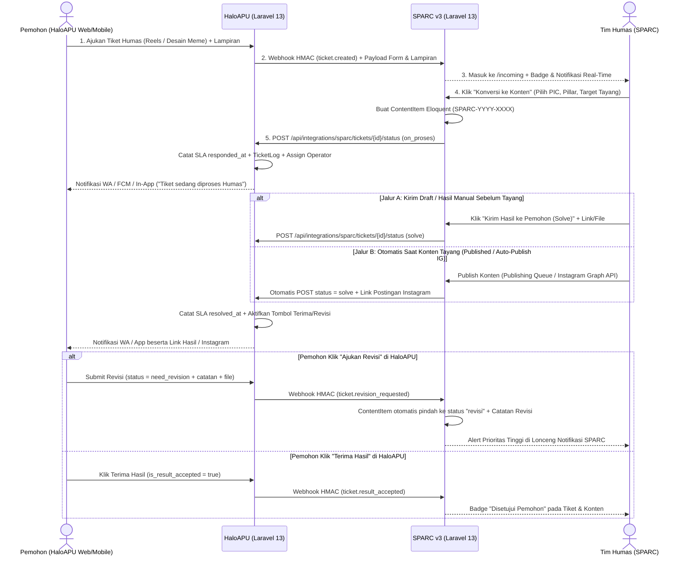

# Rencana Implementasi: Integrasi 2-Arah HaloAPU ↔ SPARC v3

Dokumen ini merinci arsitektur dan langkah implementasi penghubung **dua arah (End-to-End Lifecycle + SLA Sync)** antara aplikasi tiket internal **HaloAPU** ([HaloAPU-main](file:///mnt/c/Users/IT%20Dev/Documents/HaloAPU-main)) dan ruang kerja manajemen konten Humas **SPARC v3** ([SPARC](file:///mnt/c/Users/IT%20Dev/Documents/SPARC)).

> [!IMPORTANT]
> **Ruang Lingkup Filter Layanan (Hasil Kesepakatan):**
> Integrasi hanya menarik dan menyinkronkan tiket di bawah Unit **Humas** yang memenuhi kriteria spesifik pada [FormFieldSeeder.php](file:///mnt/c/Users/IT%20Dev/Documents/HaloAPU-main/database/seeders/FormFieldSeeder.php):
> 1. **Editing Reels** (`sourceType = video_reels`): Sub-Unit *Editing & Produksi Video* dengan nilai field `Jenis Video` = **`Reels`**.
> 2. **Desain Meme** (`sourceType = desain_feed`): Sub-Unit *Pengajuan Desain Grafis* dengan nilai field `Jenis Produksi Desain` = **`Feed Instagram / Meme`** atau **`Meme Al-Kisah`**.
> *(Aturan kata kunci ini disimpan secara dinamis sehingga tetap dapat disesuaikan melalui menu Pengaturan/Settings di kedua aplikasi tanpa perlu mengubah kode).*

---

## 1. Arsitektur & Alur Siklus Hidup 2-Arah

Kedua aplikasi sama-sama berjalan di atas **Laravel 13.8 + PHP 8.3 + Inertia v3 + React**. Komunikasi dirancang menggunakan **Server-to-Server (S2S) REST API (Bearer Token)** dikombinasikan dengan **Real-Time Webhook bersegel HMAC-SHA256** dan **Scheduled Fallback Sync**, sehingga aman dijalankan baik di jaringan lokal beda port (`localhost:8000` ↔ `localhost:8001`) maupun di server produksi beda domain (`haloapu.id` ↔ `sparc.id`).

---

## 2. Perubahan pada Repositori HaloAPU (`C:\Users\IT Dev\Documents\HaloAPU-main`)

Sisi HaloAPU bertindak sebagai **Sumber Tiket (Source of Truth SLA & Pemohon)** yang mengekspor tiket Reels/Meme ke SPARC dan menerima pembaruan status/balasan/hasil dari SPARC.

### 2.1 Konfigurasi & Layanan Integrasi SPARC
- **[MODIFY] [services.php](file:///mnt/c/Users/IT%20Dev/Documents/HaloAPU-main/config/services.php) & [.env.example](file:///mnt/c/Users/IT%20Dev/Documents/HaloAPU-main/.env.example)**
  - Menambahkan blok `services.sparc` sebagai nilai fallback `.env` (`SPARC_INTEGRATION_ENABLED`, `SPARC_BASE_URL`, `SPARC_API_TOKEN`, `SPARC_WEBHOOK_SECRET`), sementara nilai aktif utama dikelola dinamis melalui tabel `system_configs` (`SystemConfig::getValue(...)`).
- **[NEW] `app/Services/SparcIntegrationService.php` (di `HaloAPU-main`)**
  - `matchesSparcFilter(Ticket $ticket): ?string`: Mengevaluasi apakah tiket berada di Unit `Humas` dan field dinamisnya cocok dengan aturan filter (`Jenis Video` = `Reels` → `'video_reels'`; `Jenis Produksi Desain` ∈ `['Feed Instagram / Meme', 'Meme Al-Kisah']` → `'desain_feed'`).
  - `serializeTicketForSparc(Ticket $ticket): array`: Mengubah `form_data` berbasis `field_id` menjadi pasangan `{ "Label Field": "Nilai" }` menggunakan relasi `subUnit.formFields`, menyertakan info pemohon (`user` / `createdByAdmin`, `orgDivisi`, `orgUnit`, `no_wa`), deadline (`Deadline Tayang` / `Deadline`), status SLA (`TicketSlaTracking`), daftar `TicketAttachment`, dan riwayat `TicketLog`.
  - `dispatchWebhook(string $event, Ticket $ticket, array $extra = []): array`: Mengirimkan HTTP POST bersegel header `X-HaloAPU-Event`, `X-HaloAPU-Timestamp`, dan `X-HaloAPU-Signature` (`sha256=...`) ke `{sparc_base_url}/api/webhooks/haloapu` (dijalankan aman setelah transaksi komit dan memiliki proteksi anti-loop apabila perubahan berasal dari SPARC sendiri).
  - `resolveActingAdmin(?string $actorEmail, ?string $actorName, ?Ticket $ticket = null): ?Admin`: Mencocokkan email/nama PIC SPARC ke tabel `admins` HaloAPU, dengan fallback ke `sparc_default_admin_id` (atau admin unit Humas pertama) agar `TicketLog` dan `assigned_admin_id` di HaloAPU selalu valid.

### 2.2 Endpoint REST API S2S & Middleware Keamanan
- **[NEW] `app/Http/Middleware/VerifySparcIntegrationToken.php` (di `HaloAPU-main`)**
  - Memvalidasi header `Authorization: Bearer <sparc_api_token>` menggunakan `hash_equals` terhadap token integrasi di `SystemConfig` / `config('services.sparc.api_token')` tanpa terblokir fitur *Device Lock 1 HP* milik mobile app.
- **[NEW] `app/Http/Controllers/Api/SparcIntegrationController.php` (di `HaloAPU-main`)**
  - `GET /api/integrations/sparc/ping`: Health-check koneksi, mengembalikan versi info, daftar Sub-Unit Humas, dan jumlah tiket Reels/Meme aktif.
  - `GET /api/integrations/sparc/tickets`: Mengambil daftar tiket Humas yang lolos filter Reels & Meme (mendukung filter `updated_since`, `status`, `search`, dan `per_page`) lengkap dengan snapshot form, lampiran, dan log.
  - `GET /api/integrations/sparc/tickets/{id}`: Mengambil detail satu tiket (`formatted_id` `045-812-901` maupun integer 9 digit).
  - `POST /api/integrations/sparc/tickets/{id}/status`: Mengubah status tiket (`on_proses`, `pending`, `solve`, `reject`), memperbarui `TicketSlaTracking` (`responded_at`, `pauseSla`, `resumeSla`, `resolved_at` melalui [SlaCalculator.php](file:///mnt/c/Users/IT%20Dev/Documents/HaloAPU-main/app/Services/SlaCalculator.php)), menyimpan file lampiran hasil jika ada, mencatat `TicketLog`, dan memicu notifikasi WA/FCM/In-App resmi HaloAPU ke pemohon.
  - `POST /api/integrations/sparc/tickets/{id}/reply`: Mengirimkan balasan komentar Humas + lampiran dari SPARC ke `TicketLog`, menyinkronkannya ke modul chat lewat [TicketChatBridgeService.php](file:///mnt/c/Users/IT%20Dev/Documents/HaloAPU-main/app/Services/TicketChatBridgeService.php), dan mengirim notifikasi ke pemohon.
  - `GET /api/integrations/sparc/attachments/{attachment}`: Streaming biner file lampiran secara aman untuk proxy SPARC.
- **[MODIFY] [api.php](file:///mnt/c/Users/IT%20Dev/Documents/HaloAPU-main/routes/api.php) & [bootstrap/app.php](file:///mnt/c/Users/IT%20Dev/Documents/HaloAPU-main/bootstrap/app.php)**
  - Mendaftarkan grup rute `/api/integrations/sparc/*` dengan middleware alias `sparc.token`.

### 2.3 Kait (Hooks) Pengiriman Webhook Otomatis di HaloAPU
Menambahkan pemanggilan ringan `app(SparcIntegrationService::class)->notifyIfEligible($ticket, $event)` pada titik siklus tiket pemohon & admin (Web maupun Mobile API):
- **[MODIFY] [TicketWizardController.php](file:///mnt/c/Users/IT%20Dev/Documents/HaloAPU-main/app/Http/Controllers/User/TicketWizardController.php)** (`store` → `ticket.created`)
- **[MODIFY] [TicketHistoryController.php](file:///mnt/c/Users/IT%20Dev/Documents/HaloAPU-main/app/Http/Controllers/User/TicketHistoryController.php)** (`reply` → `ticket.replied`, `cancel` → `ticket.cancelled`, `requestRevision` → `ticket.revision_requested`, `acceptResult` → `ticket.result_accepted`)
- **[MODIFY] [Admin/TicketController.php](file:///mnt/c/Users/IT%20Dev/Documents/HaloAPU-main/app/Http/Controllers/Admin/TicketController.php)** (`store` → `ticket.created`, `updateStatus` → `ticket.status_updated`, `cancel` → `ticket.cancelled`, `reply` → `ticket.replied`)
- **[MODIFY] [Api/TicketController.php](file:///mnt/c/Users/IT%20Dev/Documents/HaloAPU-main/app/Http/Controllers/Api/TicketController.php)** (`store`, `reply`, `cancel`, `requestRevision`, `acceptResult`, `changeStatus`)

### 2.4 Panel UI Konfigurasi Integrasi SPARC di Admin HaloAPU
- **[MODIFY] [SystemConfigController.php](file:///mnt/c/Users/IT%20Dev/Documents/HaloAPU-main/app/Http/Controllers/Admin/SystemConfigController.php) & [web.php](file:///mnt/c/Users/IT%20Dev/Documents/HaloAPU-main/routes/web.php)**
  - Menyimpan & menampilkan pengaturan `sparc_integration_enabled`, `sparc_base_url`, `sparc_api_token`, `sparc_webhook_secret`, `sparc_default_admin_id`, dan `sparc_filter_rules`.
  - Menambahkan endpoint `POST /admin/konfigurasi/test-sparc` (mengirim ping webhook bertanda tangan HMAC ke SPARC) dan `POST /admin/konfigurasi/generate-sparc-credentials`.
- **[MODIFY] [Konfigurasi/Index.tsx](file:///mnt/c/Users/IT%20Dev/Documents/HaloAPU-main/resources/js/Pages/Admin/Konfigurasi/Index.tsx)**
  - Menambahkan tab baru **"Integrasi SPARC"** berisi toggle aktivasi, input URL SPARC, generator & tombol salin API Token + Webhook Secret, dropdown Operator Default Humas, kustomisasi kata kunci filter (`Reels`, `Feed Instagram / Meme`, `Meme Al-Kisah`), dan tombol **Tes Koneksi ke SPARC**.

---

## 3. Perubahan pada Repositori SPARC (`C:\Users\IT Dev\Documents\SPARC`)

Sisi SPARC ditingkatkan dari sekadar array statis di session menjadi sistem manajemen tiket masuk berbasis database yang terhubung langsung dengan Eloquent [ContentItem.php](file:///mnt/c/Users/IT%20Dev/Documents/SPARC/app/Models/ContentItem.php) dan penerbitan Instagram.

### 3.1 Skema Database & Model Eloquent Baru
- **[NEW] Migration `database/migrations/2026_11_04_040000_create_haloapu_integration_tables.php`**
  1. Tabel **`haloapu_connections`**:
     - `id`, `is_enabled` (`boolean`), `base_url` (`string`), `api_token` (`text`, encrypted), `webhook_secret` (`text`, encrypted), `auto_solve_on_publish` (`boolean`, default `true`), `filter_rules` (`json`), `last_synced_at` (`timestamp`), `last_webhook_at` (`timestamp`), `last_status` (`string`), `last_error` (`text`), `timestamps()`.
  2. Tabel **`haloapu_tickets`**:
     - `id`, `haloapu_ticket_id` (`string`, unique, mis. `045-812-901`), `raw_ticket_id` (`unsignedBigInteger`, index), `source_type` (`video_reels` | `desain_feed`), `sub_unit_name` (`string`), `title` (`string`), `brief` (`text`), `requester_name` (`string`), `requester_unit` (`string`), `requester_whatsapp` (`string`, nullable), `assigned_operator_name` (`string`, nullable), `priority` (`string`), `target_date` (`date`, nullable), `haloapu_status` (`string`), `sync_status` (`pending` | `converted` | `ignored`), `is_result_accepted` (`boolean`), `revision_count` (`unsignedInteger`), `sla_response_deadline` (`timestamp`, nullable), `sla_resolution_deadline` (`timestamp`, nullable), `is_sla_breached` (`boolean`), `form_snapshot` (`json`), `attachments_payload` (`json`), `logs_payload` (`json`), `content_item_id` (`foreignId` nullable → `content_items.id`), `deliverable_url` (`string`, nullable), `haloapu_created_at` (`timestamp`, nullable), `last_synced_at` (`timestamp`, nullable), `softDeletes()`, `timestamps()`.
  3. Tabel **`haloapu_sync_logs`**:
     - `id`, `direction` (`inbound_webhook` | `outbound_push` | `manual_pull` | `scheduled_pull`), `event_type` (`string`), `status` (`success` | `failed`), `fetched_count` (`unsignedInteger`), `latency_ms` (`unsignedInteger`), `http_status` (`unsignedSmallInteger`, nullable), `note` (`text`), `timestamps()`.
- **[NEW] Models `app/Models/HaloApuConnection.php`, `app/Models/HaloApuTicket.php`, `app/Models/HaloApuSyncLog.php`**
- **[MODIFY] [ContentItem.php](file:///mnt/c/Users/IT%20Dev/Documents/SPARC/app/Models/ContentItem.php) & [ContentItemResource.php](file:///mnt/c/Users/IT%20Dev/Documents/SPARC/app/Http/Resources/ContentItemResource.php)**
  - Menambahkan relasi `haloApuTicket(): HasOne` pada `ContentItem` serta mengekspor metadata tiket terhubung (`haloapuStatus`, `isResultAccepted`, `revisionCount`, `deliverableUrl`) ke frontend.

### 3.2 Service Client, Webhook Receiver, & Penjadwalan Otomatis
- **[MODIFY] [services.php](file:///mnt/c/Users/IT%20Dev/Documents/SPARC/config/services.php) & [.env.example](file:///mnt/c/Users/IT%20Dev/Documents/SPARC/.env.example)**
  - Menambahkan konfigurasi default `services.haloapu` (`HALOAPU_BASE_URL`, `HALOAPU_API_TOKEN`, `HALOAPU_WEBHOOK_SECRET`).
- **[NEW] `app/Services/HaloApuClientService.php`**
  - Klien HTTP Laravel 13 (`Http::withToken(...)->timeout(15)->retry(2, 300)`) untuk:
    - `testConnection()`: Memanggil `/api/integrations/sparc/ping`.
    - `syncTickets(?string $updatedSince = null)`: Menarik daftar tiket Reels & Meme dari HaloAPU, melakukan upsert ke `haloapu_tickets`, dan mencatat `HaloApuSyncLog`.
    - `pushTicketStatus(HaloApuTicket $ticket, string $status, ?string $note, array $files = [], ?string $deliverableUrl = null)`: Mengirim perubahan status (`on_proses`, `pending`, `solve`, `reject`) ke HaloAPU.
    - `pushTicketReply(HaloApuTicket $ticket, string $note, array $files = [])`: Mengirim balasan pesan & file lampiran ke pemohon HaloAPU.
    - `streamAttachment(HaloApuTicket $ticket, int $attachmentId)`: Mengambil stream lampiran dari HaloAPU untuk preview/unduh atau impor ke Visual Assets SPARC.
    - `handlePublishedContent(ContentItem $item, ?string $publishedUrl = null)`: Helper terpusat yang otomatis menandai tiket HaloAPU menjadi `solve` (beserta tautan tayang Instagram/medsos) saat `auto_solve_on_publish` aktif.
- **[NEW] `app/Http/Controllers/HaloApuWebhookController.php` & `routes/api.php` (di `SPARC`)**
  - Mendaftarkan `api: __DIR__.'/../routes/api.php'` pada [bootstrap/app.php](file:///mnt/c/Users/IT%20Dev/Documents/SPARC/bootstrap/app.php) (stateless & bebas blokir CSRF untuk endpoint eksternal).
  - Memverifikasi tanda tangan `X-HaloAPU-Signature` (`hash_hmac('sha256', ...)`) dan memproses event real-time:
    - `ping` → catat log koneksi sehat.
    - `ticket.created` / `ticket.status_updated` → upsert `HaloApuTicket` + dorong notifikasi workspace.
    - `ticket.replied` → tambahkan riwayat balasan pemohon ke `HaloApuTicket` & ke `ContentComment` (jika sudah jadi konten).
    - `ticket.revision_requested` → ubah `haloapu_status = 'need_revision'`, pindahkan `ContentItem` terkait ke status **`revisi`**, isi `revision_note`, catat `ContentWorkflowHistory`, dan munculkan notifikasi revisi.
    - `ticket.result_accepted` → tandai `is_result_accepted = true`.
    - `ticket.cancelled` → tandai `haloapu_status = 'dibatalkan'` (serta `sync_status = 'ignored'` bila belum dikonversi).
- **[NEW] `app/Http/Controllers/HaloApuOperationsController.php`**
  - `convertTicket`: Menggantikan konversi berbasis session lama menjadi pembuatan `ContentItem` Eloquent nyata (`SPARC-YYYY-XXXX`), menyalin brief + deadline + referensi dari `form_snapshot`, lalu otomatis menembak status `on_proses` ke HaloAPU (tetap kompatibel mundur dengan tiket demo apabila integrasi belum dikonfigurasi agar seluruh test existing tetap lulus).
  - `ignoreTicket`: Mengabaikan tiket (`sync_status = 'ignored'`) atau menolak (`reject`) dengan catatan ke HaloAPU.
  - `replyTicket`: Membalas pesan + unggah file ke pemohon HaloAPU langsung dari SPARC.
  - `updateRemoteStatus`: Mengubah status ke `pending` (minta klarifikasi pemohon / pause SLA HaloAPU) atau `on_proses`.
  - `deliverResult`: Tombol manual **"Kirim Hasil ke Pemohon (`solve`)"** dengan tautan preview/Drive/Canva + lampiran file sebelum atau tanpa harus tayang di IG.
  - `proxyAttachment` & `saveAttachmentToAssets`: Membuka/mengunduh lampiran tiket dengan aman dan mengimpor lampiran menjadi item di perpustakaan Visual Assets SPARC dalam 1 klik.
- **[MODIFY] Integrasi Otomatis Saat Konten Tayang (`published`)**:
  - [WorkspaceV3Controller.php](file:///mnt/c/Users/IT%20Dev/Documents/SPARC/app/Http/Controllers/WorkspaceV3Controller.php): Memperbarui `defaultIncomingTickets()` (membaca `HaloApuTicket` dari DB dengan fallback tiket seed saat belum ada data), `settings()`, `syncHaloApu()`, serta memanggil `HaloApuClientService::handlePublishedContent()` di `markPublished()`, `updateContentStatus()`, dan `updateContent()`.
  - [InstagramOperationsController.php](file:///mnt/c/Users/IT%20Dev/Documents/SPARC/app/Http/Controllers/InstagramOperationsController.php) & [InstagramGraphService.php](file:///mnt/c/Users/IT%20Dev/Documents/SPARC/app/Services/InstagramGraphService.php): Saat Reels/Feed langsung tayang atau jadwal Auto-Publish Instagram selesai tayang dan memperoleh permalink Instagram, otomatis mengirimkan permalink tersebut ke tiket HaloAPU sebagai `solve`!
  - [console.php](file:///mnt/c/Users/IT%20Dev/Documents/SPARC/routes/console.php): Menambahkan command `haloapu:sync-tickets` yang dijadwalkan berjalan otomatis setiap 15 menit (`everyFifteenMinutes()->withoutOverlapping()`).

### 3.3 Peningkatan Antarmuka Pengguna (Frontend Inertia React) di SPARC
- **[MODIFY] [sparc.ts](file:///mnt/c/Users/IT%20Dev/Documents/SPARC/resources/js/types/sparc.ts)**
  - Memperluas tipe `DashboardIncomingTicket`, `HaloApuSettingsPayload`, dan metadata tiket pada `ContentItem`.
- **[MODIFY] [Settings/Index.tsx](file:///mnt/c/Users/IT%20Dev/Documents/SPARC/resources/js/Pages/Settings/Index.tsx)**
  - Meningkatkan kartu **"Integrasi REST API HALO APU"** menjadi panel konfigurasi utuh (sejajar dengan panel Instagram Graph API): input Base URL HaloAPU, API Token, Webhook Secret, URL Endpoint Webhook SPARC siap-salin (`/api/webhooks/haloapu`), toggle *Auto-Solve saat Konten Published*, kustomisasi kata kunci filter (`Reels`, `Feed Instagram / Meme`, `Meme Al-Kisah`), tombol **Tes Koneksi**, tombol **Sinkronisasi Sekarang**, dan log sinkronisasi real-time dari database.
- **[MODIFY] [Incoming/Index.tsx](file:///mnt/c/Users/IT%20Dev/Documents/SPARC/resources/js/Pages/Incoming/Index.tsx)**
  - Menambahkan tombol **Sync Sekarang** di header halaman Incoming.
  - Menampilkan indikator SLA HaloAPU (Tenggat Respons/Penyelesaian & badge Revisi ke-N / Disetujui Pemohon).
  - Pada Drawer Detail Tiket:
    - Tombol **Lihat / Unduh** lampiran via proxy aman + tombol 1-klik **"Simpan ke Aset SPARC"**.
    - Tab/Bagian **Komunikasi & Balasan ke Pemohon HaloAPU** (kirim pesan teks + lampiran file langsung ke HaloAPU).
    - Tombol aksi siklus tiket: **Konversi ke Konten (`on_proses`)**, **Minta Info / Pause SLA (`pending`)**, **Kirim Hasil ke Pemohon (`solve`)**, dan **Tolak Tiket (`reject`)**.
- **[MODIFY] [ContentDetailSheet.tsx](file:///mnt/c/Users/IT%20Dev/Documents/SPARC/resources/js/Components/ContentDetailSheet.tsx)**
  - Menampilkan kartu status keterhubungan tiket HaloAPU (`#045-812-901`, status saat ini di HaloAPU, badge revisi pemohon bila `need_revision`) beserta tombol pintas **"Kirim Hasil Draft ke Pemohon HaloAPU (`solve`)"** langsung dari panel detail konten.

---

## 4. Rencana Verifikasi & Pengujian

> [!TIP]
> Kedua repositori menggunakan PHPUnit dengan SQLite `:memory:`, sehingga seluruh alur lintas aplikasi (termasuk tanda tangan HMAC webhook, filter khusus Reels & Meme, kalkulasi SLA HaloAPU, dan auto-solve saat publish Instagram) akan diuji secara otomatis tanpa merusak data lokal Anda.

### 4.1 Pengujian Otomatis di HaloAPU (`HaloAPU-main`)
1. **[NEW] `tests/Feature/SparcIntegrationTest.php`**:
   - Memastikan tiket Humas dengan `Jenis Video = Reels` serta `Jenis Produksi Desain = Feed Instagram / Meme` & `Meme Al-Kisah` lolos filter & memicu pengiriman Webhook bersegel `X-HaloAPU-Signature` yang valid.
   - Memastikan tiket Humas di luar kategori tersebut (mis. `Spanduk`, `Sertifikat`, `Motion Graphic`, atau *Dokumentasi Event*) **tidak** dikirim ke SPARC.
   - Menguji endpoint S2S (`GET /api/integrations/sparc/tickets`, `POST .../status` untuk `on_proses` → mencatat `responded_at` SLA, `solve` → mencatat `resolved_at` SLA, `POST .../reply`, serta proteksi token tidak valid `401`).
   - Menguji pengiriman webhook otomatis `ticket.revision_requested` saat pemohon menekan Ajukan Revisi dan `ticket.cancelled` saat pemohon membatalkan tiket.
2. Menjalankan formatter, typecheck, build, dan test suite HaloAPU:
   - `php.exe vendor/bin/pint --dirty --format agent`
   - `cmd.exe /c "npm run build"`
   - `php.exe artisan test --compact`

### 4.2 Pengujian Otomatis di SPARC (`SPARC`)
1. **[NEW] `tests/Feature/HaloApuIntegrationTest.php`**:
   - Menguji verifikasi HMAC-SHA256 pada `POST /api/webhooks/haloapu` (menolak signature palsu `401`, menerima `ticket.created`, `ticket.replied`, `ticket.revision_requested`, `ticket.result_accepted`, dan `ticket.cancelled`).
   - Menguji alur `POST /incoming/{id}/convert` yang membuat `ContentItem` Eloquent nyata (`SPARC-YYYY-XXXX`) dan menembak status `on_proses` ke HaloAPU via `Http::fake()`.
   - Menguji alur revisi pemohon (`ticket.revision_requested`) yang otomatis memindahkan status `ContentItem` menjadi `revisi` beserta catatan revisinya.
   - Menguji kedua jalur penyelesaian tiket (`solve`): tombol manual **"Kirim Hasil ke Pemohon"** dan jalur otomatis saat `ContentItem` berstatus `published` (termasuk saat publish ke Instagram).
   - Menguji proxy lampiran & tombol 1-klik **"Simpan ke Aset SPARC"**.
2. Memastikan seluruh pengujian regresi SPARC tetap hijau 100%:
   - `php.exe vendor/bin/pint --dirty --format agent`
   - `cmd.exe /c "npx tsc --noEmit"`
   - `cmd.exe /c "npm run build"`
   - `php.exe artisan test --compact` (termasuk [WorkspaceFlowTest.php](file:///mnt/c/Users/IT%20Dev/Documents/SPARC/tests/Feature/WorkspaceFlowTest.php) dan [InstagramMaxIntegrationTest.php](file:///mnt/c/Users/IT%20Dev/Documents/SPARC/tests/Feature/InstagramMaxIntegrationTest.php)).
